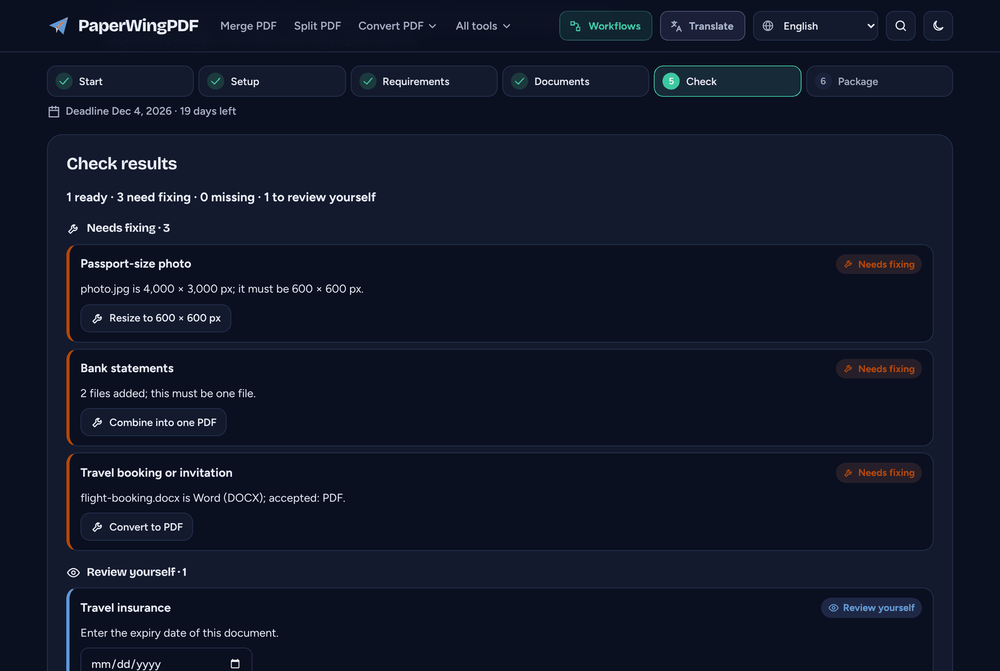
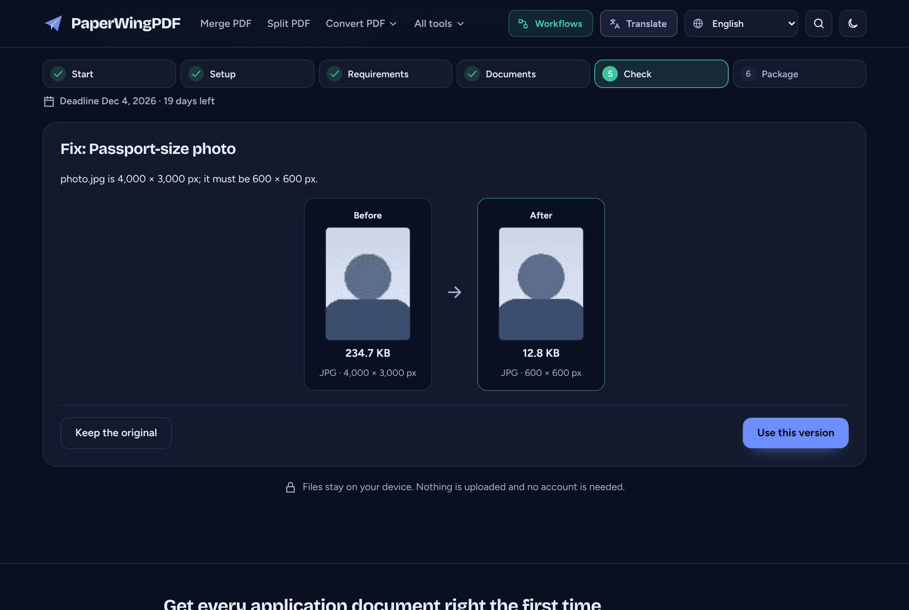
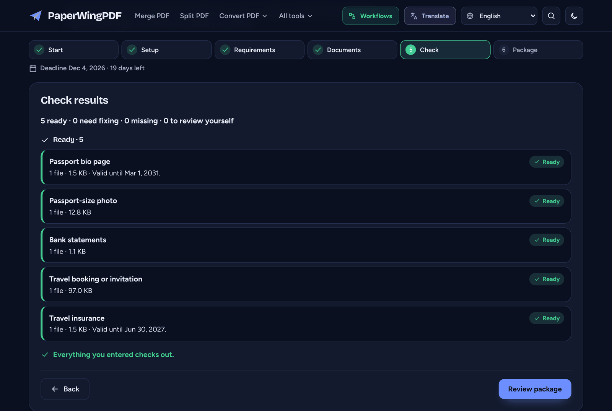
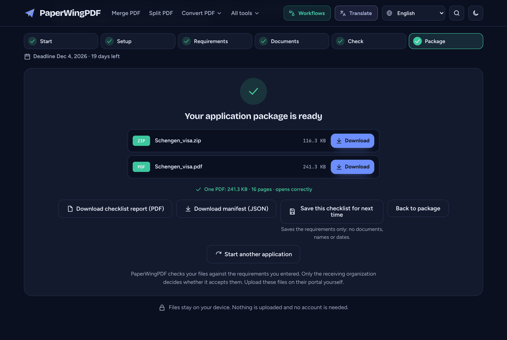
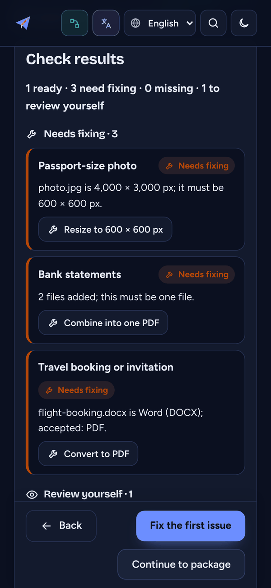

# Paperwing PDF

**60 free PDF tools that run entirely in your browser. Your files never leave your device.**

🌐 **[paperwingpdf.com](https://paperwingpdf.com)**

No account · No watermark · No daily limit · Works offline · 12 languages, including Arabic and Urdu

---

## Why Paperwing?

Most online PDF tools upload your documents to their servers. Paperwing doesn't. Every tool runs on your own computer or phone, so contracts, invoices, CVs, ID photos and medical records stay private. Once a tool has been opened, it keeps working without an internet connection.

## New in November 2026

- **PaperWingPDF Writing Check for Windows** – a free grammar checker and writing assistant for Word, Outlook, Chrome, Edge and other Windows programs. Mistakes are underlined as you type; select any text and click **✦ Improve** to polish, rephrase, change the tone or translate it. A private AI runs on your PC, so your emails and documents are never uploaded, and it works offline. [Get it from the Microsoft Store](https://apps.microsoft.com/detail/9P8NJHS3ZBM7)
- **Prepare an application** – a guided checklist for job, university, visa, government and tender applications. Enter the portal's rules (format, size limit, pages, photo size, signature, expiry date), add your files, see what's missing or wrong, fix most problems in one click and download one package as a ZIP or a single PDF. Nothing is uploaded. [Try it](https://paperwingpdf.com/prepare-application/)
- **AI writing assistant** – fix grammar and spelling, make emails more formal or friendly, shorten text or draft a reply. It runs on your device, so your text is never sent anywhere.
- **Chat with PDF** – ask questions about a PDF and get answers with page numbers. Nothing is uploaded.
- **PDF quiz maker** – turn notes and chapters into multiple-choice quizzes with an answer key.
- **Resize image to KB** – make photos and signatures fit form limits like 20 KB or 50 KB.
- **CV & resume checker** – see whether hiring software (ATS) can read your CV.

## Screenshots

**Prepare an application:** enter a portal's rules, add your files, fix what's wrong, download one package.

| Check results | One-click fix with before and after |
|---|---|
|  |  |
| **Everything ready** | **Package created: ZIP, single PDF, report and manifest** |
|  |  |

Screenshots use sample documents. Everything shown runs in the browser; no file is uploaded.

## 60 tools in one place

**Organize:** Merge PDF, Split PDF, Remove pages, Remove blank pages, Extract pages, Organize PDF, Rotate PDF, Resize pages, Pages per sheet, Make a booklet, Merge scanned sides

**Optimize:** Compress PDF, Upload-ready PDF, Resize image to KB, Repair PDF, Grayscale PDF, OCR PDF

**Convert to PDF:** JPG to PDF, Scan to PDF, Word to PDF, PowerPoint to PDF, Excel to PDF, HTML to PDF

**Convert from PDF:** PDF to JPG, PDF to PNG, Extract images, PDF to Word, PDF to Text, PDF to PowerPoint, PDF to Excel, PDF to PDF/A

**Edit & sign:** Edit PDF, Sign PDF, Annotate PDF, Fill PDF forms, Flatten PDF, Page numbers, Header & footer, Bates numbering, Add bookmarks, Add watermark, Crop PDF

**Security & privacy:** Hide personal info, Seal PDF, Verify sealed PDF, Check PDF safety, Remove hidden data, Protect PDF, Unlock PDF, Redact PDF, Edit PDF metadata

**PDF intelligence:** AI writing assistant, Chat with PDF, PDF quiz maker, CV & resume checker, Compare PDF, AI Summarizer, Translate PDF, PDF to Markdown, Listen to PDF

## Highlights

- **Hide personal info** – finds names, emails, phone numbers, ID and card numbers, and lets you review every match before it is removed for good.
- **Seal & verify** – add a tamper-evident seal to a PDF, and let anyone check later that it hasn't been changed.
- **Upload-ready PDF** – shrinks a document to fit a form's size limit (for example 200 KB) in one step.
- **Prepare an application** – checks every document against an application's rules, fixes common problems and builds a ready-to-upload package.
- **Workflows** – chain several tools together and reuse the steps.
- **Private translation** – translate PDFs into 40+ languages on your device.

## Works everywhere

Use it in any modern browser on Windows, Mac, Linux, Android and iPhone, or install one of the apps:

| | What it does | Get it |
|---|---|---|
| **PaperWingPDF Writing Check** (new) | Checks your English as you type in Word, Outlook, Chrome, Edge and other Windows programs. Private AI on your PC; works offline. | [Microsoft Store](https://apps.microsoft.com/detail/9P8NJHS3ZBM7) |
| **PaperWingPDF for Windows** | All PDF tools as a Windows app | [Microsoft Store](https://apps.microsoft.com/detail/9pd9d615pf7p) |
| **Browser extension** | PDF tools, plus the writing check in Gmail, Outlook on the web and other sites | [Chrome](https://chromewebstore.google.com/detail/hfleiiikpokjfljncenddgkpegldgkpg) · [Edge](https://microsoftedge.microsoft.com/addons/detail/paperwingpdf-%E2%80%93-private-pd/idcfphbfgpdgckeaefjifcaoekjdjnai) |
| **Word & Outlook add-in** | Writing check inside Word and Outlook, including on the web and Mac | [paperwingpdf.com/office](https://paperwingpdf.com/office/) |

## Feedback

Found a bug or have an idea? [Open an issue](../../issues) or use the [contact page](https://paperwingpdf.com/contact/).
